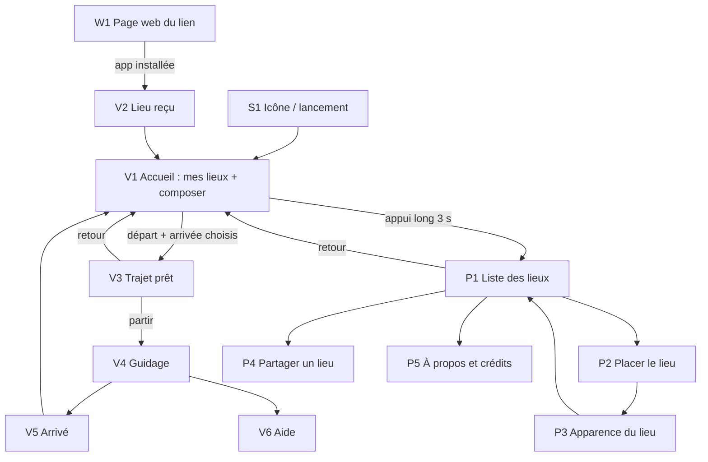

# Inventaire des écrans

Base pour les maquettes. Chaque écran : qui le voit, sa décision unique, son contenu, ses états, où il mène.

- **Statut** : `spec` = décrit par une spec validée ; `exploratoire` = la spec n'existe pas encore, les maquettes servent à trancher les questions listées.
- Préfixes : **V** = voyageur (zéro texte, zéro chiffre), **P** = préparation (texte en français autorisé), **W** = page web du lien, **S** = système (icône, lancement).

## Vue d'ensemble

## Voyageur

### V1 — Accueil : mes lieux (et composer un trajet)

- **Statut** : `spec` (001) pour la grille ; `exploratoire` (002) pour la composition.
- **Décision unique** : où je vais.
- **Contenu** :
  - Grille de grandes cartes de lieux, qui défile. Avec photo : photo plein cadre, cadre épais couleur, pastille pictogramme. Sans photo : grand pictogramme sur fond couleur. Ordre : « maison » d'abord, puis du plus récent au plus ancien.
  - (002) En haut, la **barre de trajet** : une ligne droite avec deux cases vides, départ à gauche, arrivée à droite (idée du porteur du projet). Toucher un lieu le place dans la première case vide ; le glisser vers une case marche aussi. Toucher une case pleine la vide.
  - (002) Un lieu spécial **« ici »** (ma position) pour le départ.
  - Symbole discret de préparation dans un coin : appui long de 3 s, il se remplit pendant l'appui.
- **États** :
  - vide (aucun lieu) : visuel d'attente, pas de grille ;
  - normal ;
  - lieu juste reçu : cadre qui pulse quelques secondes ;
  - (002) une case remplie ; deux cases remplies (passage à V3) ;
  - (002) GPS indisponible : « ici » grisé.
- **Questions ouvertes (002)** :
  - Le sens de la ligne (départ à gauche) est-il naturel pour une personne qui lit de droite à gauche (arabe, dari, pachto) ? Une ligne verticale (départ en bas, arrivée en haut, comme une montée) évite le problème.
  - Départ par défaut sur « ici » si le GPS est disponible, pour n'avoir qu'un seul choix à faire ?
  - Montrer les trajets déjà calculés (disponibles hors connexion) ? Comment, sans texte ?

### V2 — Lieu reçu

- **Statut** : `spec` (001).
- **Décision unique** : aucune, c'est une confirmation.
- **Contenu** : par-dessus l'accueil, la carte du lieu reçu qui grandit, coche verte animée, vibration courte, son de réussite. Puis retour automatique à V1, lieu mis en évidence.
- **États** :
  - succès ;
  - déjà présent : même confirmation, le lieu existant est mis en évidence ;
  - lien illisible : croix rouge animée, double vibration, son d'erreur, rien n'est ajouté.

### V3 — Trajet prêt

- **Statut** : `exploratoire` (002).
- **Décision unique** : je pars.
- **Contenu** : carte avec le tracé du chemin (D6) ; lieu de départ et lieu d'arrivée (photos, pictogrammes) aux deux bouts ; pictogramme du mode (à pied) ; durée en **quantité visuelle** (jauge, nombre de pas dessinés, cadran), jamais en chiffres ; grand bouton « partir ».
- **États** :
  - calcul en cours (internet nécessaire) ;
  - trajet déjà en mémoire : immédiat, même hors connexion ;
  - pas de réseau et trajet inconnu : pictogramme « pas de réseau » + vibration, retour à V1 ;
  - calcul impossible (service en panne, lieu inaccessible à pied) ;
  - permission de localisation pas encore donnée (voir V7).
- **Questions ouvertes** : comment représenter une durée sans chiffres ? Faut-il un bouton pour inverser départ et arrivée (le retour) ?

### V4 — Guidage

- **Statut** : `exploratoire` (003).
- **Décision unique** : je continue, je tourne ou je m'arrête.
- **Contenu** (à arbitrer) : grande flèche-boussole vers la prochaine direction ; jauge de progression jusqu'à l'arrivée ; bandeau de carte avec le tracé et ma position ; photo de l'arrivée en petit ; bouton d'aide toujours visible (V6) ; bouton pour arrêter.
- **Signaux** : bonne direction = vert + vibration douce régulière ou silence ; mauvaise direction = rouge + vibration forte ; tourner = vibration distincte gauche / droite (motifs à définir) + son.
- **États** : recherche du signal GPS ; précision faible ; bonne direction ; mauvaise direction ; hors du tracé ; presque arrivé ; écran verrouillé (vibrations et sons continuent) ; batterie faible.
- **Questions ouvertes** : voix ou seulement sons ? Que faire quand il se perd (recalcul en ligne ou retour vers le tracé) ? Flèche absolue (boussole) ou relative au trajet ?

### V5 — Arrivé

- **Statut** : `exploratoire` (003).
- **Décision unique** : aucune, c'est une confirmation, puis retour.
- **Contenu** : photo du lieu d'arrivée en grand, animation de réussite, motif de vibration propre à l'arrivée, son. Retour à V1 par un grand bouton (ou automatique).

### V6 — Aide

- **Statut** : `exploratoire` (question ouverte 6).
- **Décision unique** : j'appelle.
- **Contenu** (piste) : photo de l'accompagnateur, grand bouton d'appel. Accessible depuis V3 et V4 (et V1 ?).
- **Questions ouvertes** : qui enregistre le numéro et la photo (partie préparation) ? Plusieurs contacts ? Partage de position ponctuel ?

### V7 — Permission de localisation

- **Statut** : `exploratoire` (002).
- **Décision unique** : j'autorise.
- **Contenu** : avant la fenêtre système (écrite dans la langue du téléphone), un écran visuel qui montre pourquoi : pictogramme position + flèche + geste « toucher Autoriser ». Si refusée : écran qui montre le chemin vers les réglages, et appel à l'aide.

## Préparation (texte en français)

### P1 — Liste des lieux

- **Statut** : `spec` (001).
- **Contenu** : liste des lieux du téléphone (vignette photo ou pictogramme, couleur, petite carte) ; actions par lieu : modifier, partager, supprimer (confirmation) ; boutons « Ajouter un lieu » et « Envoyer un lieu à distance » ; lien « À propos » ; bouton « Retour » toujours visible.
- **États** : vide ; normal ; suppression en cours de confirmation.

### P2 — Placer le lieu

- **Statut** : `spec` (001).
- **Contenu** : champ de recherche d'adresse avec suggestions ; carte plein écran avec repère déplaçable ; toucher la carte pose le repère ; attribution OpenStreetMap visible ; bouton « Suivant ».
- **États** : saisie ; suggestions en cours ; aucun résultat (proposer de toucher la carte) ; pas de réseau (carte et recherche indisponibles) ; repère posé.

### P3 — Apparence du lieu

- **Statut** : `spec` (001).
- **Contenu** : grille de pictogrammes ARASAAC (une vingtaine, avec leur libellé en français pour la personne qui prépare) ; palette de 8 couleurs ; photo (appareil ou galerie, recadrage au format de la carte) ; **aperçu en direct de la carte telle que le voyageur la verra** ; bouton « Enregistrer ».
- **Variante « Envoyer un lieu à distance »** : pas de photo ; le bouton devient « Partager » et ouvre la feuille de partage du téléphone.
- **États** : permission appareil photo ou galerie refusée ; photo en cours de traitement.

### P4 — Partager un lieu

- **Statut** : `spec` (001).
- **Contenu** : aperçu de la carte du lieu, rappel « Le voyageur doit avoir l'app installée ; la photo n'est pas envoyée », bouton « Partager » vers la feuille de partage système.

### P5 — À propos et crédits

- **Statut** : `spec` (001, crédit ARASAAC).
- **Contenu** : crédits ARASAAC (licence CC BY-NC-SA), OpenStreetMap, OpenFreeMap ; phrase sur la confidentialité (rien ne quitte le téléphone, sauf recherche d'adresse et carte).

## Page web du lien

### W1 — Lien touché sans l'app

- **Statut** : `spec` (001).
- **Public** : le voyageur, donc **sans texte** autant que possible.
- **Contenu** : icône de l'app ; grand bouton store (Play Store ou App Store selon le téléphone) ; schéma visuel en 2 temps : « installer » puis « retoucher le lien » ; bouton « ouvrir l'app » au cas où l'app est installée mais le lien s'est ouvert dans le navigateur.

## Système

### S1 — Icône et écran de lancement

- **Contenu** : icône reconnaissable sans texte, distincte des autres applis de carte (Google Maps, Waze). Écran de lancement simple, même visuel.

## Composants communs

- **Carte de lieu** (V1, V2, V3, V5, P1, P3) : avec et sans photo, normale, mise en évidence, dans une case de la barre de trajet, petite (vignette).
- **Barre de trajet** (V1, V3) : cases vides, une pleine, deux pleines.
- **Retours** : succès (coche verte), erreur (croix rouge), attente (sans sablier ni texte).
- **Bouton d'aide** (V3, V4) : position fixe, même forme partout.
- **Symbole de préparation** (V1) : discret, remplissage pendant l'appui long.
- **Pictogrammes système** : pas de réseau, pas de GPS, batterie faible, à pied.

## Vocabulaire de signaux (à compléter avec les maquettes)

| Événement          | Visuel                    | Vibration       | Son             |
| ------------------ | ------------------------- | --------------- | --------------- |
| Succès             | Coche verte animée        | Courte, simple  | Son de réussite |
| Erreur             | Croix rouge animée        | Double          | Son d'erreur    |
| Entrée préparation | Symbole rempli            | Courte          | Aucun           |
| Bonne direction    | Vert (003)                | À définir (003) | À définir       |
| Mauvaise direction | Rouge (003)               | Forte (003)     | À définir       |
| Arrivée            | Photo en grand, animation | Motif propre    | Son propre      |
