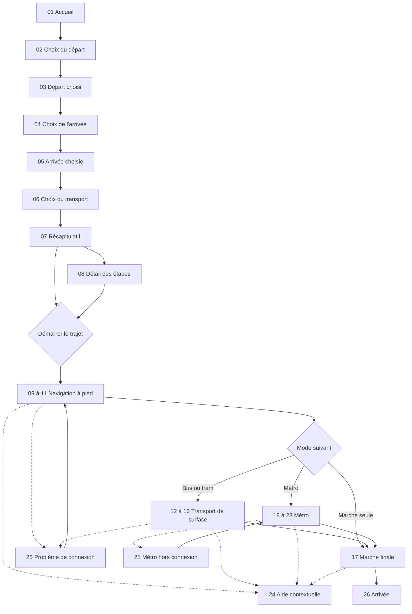

# Application de navigation sans lecture — Référentiel des écrans et workflow

**Version :** 0.1 — base de conception  
**Date :** 30 octobre 2026  
**Statut :** document de travail fondé sur les échanges et le dernier storyboard à 26 écrans.

> **Objet** — Décrire l'expérience voyageur, les états de l'interface, les transitions et les contraintes de conception. Les libellés français et les numéros d'écrans ci-dessous servent **uniquement à la documentation** : ils ne doivent pas être reproduits dans l'interface voyageur.

## 1. Vision et règles transversales

L'application permet à une personne qui ne sait pas lire, ne maîtrise pas la langue locale ou ne connaît pas la ville de préparer et suivre un itinéraire à pied, en transports en commun ou en voiture. Elle privilégie des **pictogrammes reconnaissables**, des **photos facultatives**, des **animations**, des **sons non verbaux** et des **vibrations**.

### Règles validées

1. **Pas de texte ni de chiffres dans l'interface voyageur**, avec des **exceptions limitées** : identifiants officiels des lignes de transport (ex. `C3`, `T2`, `M`) et noms réels des stations/arrêts, utiles pour comparer l'écran à la signalétique. Les **cartes d'aide contextuelle** affichent volontairement un court message en français destiné à un tiers, et non à la lecture du voyageur.
2. **Aucun guidage vocal verbal** dans le parcours normal : seulement des sons non verbaux et des vibrations. Deux exceptions fonctionnelles volontaires : **écouter le nom d'une station** et **faire lire à voix haute le message d'aide en français**.
3. L'accueil présente un **chemin** avec un point de départ et une arrivée, reconnus à leur symbole et non à leur position (spec 006). Disposition : spec 005, puis la maquette émeraude (D15).
4. Les lieux enregistrés sont identifiés par des **icônes**, éventuellement accompagnées d'**images/photos**. Ils sont configurés en amont par un accompagnateur.
5. Le départ peut être la **position actuelle** ou un **lieu enregistré** ; l'arrivée est choisie parmi les **lieux enregistrés**.
6. Le sélecteur de locomotion comporte **trois choix non ambigus** : marche, transports en commun, voiture. Le choix actualise **la durée totale** et **les étapes du trajet**. La marche d'accès aux transports figure dans le résumé, **pas comme une seconde option du sélecteur**.
7. La durée est représentée par un **cadran circulaire divisé en quatre quartiers**, avec **remplissage jaune continu proportionnel au temps réel**, sans arrondi au quart d'heure. Un cadran complet représente une heure ; plusieurs cadrans représentent les durées plus longues. Exemple : **35 minutes = deux quartiers complets et un tiers du troisième**.
8. Dans le résumé, un **cadran global** et des **cadrans par étape** emploient le même langage visuel. Pour les itinéraires longs, les étapes restent compactes ; le détail et son cadran s'ouvrent à la demande.
9. Un bouton **aide contextuelle** permet de montrer à une personne dans la rue un message français adapté à l'étape en cours. **Pas de bouton d'appel à un proche** : cette fonctionnalité a été explicitement retirée.
10. L'application doit fonctionner lors des **pertes de réseau**, notamment dans le métro, à partir des données du trajet préalablement conservées. Ne pas prétendre suivre précisément le véhicule si la position n'est pas disponible.
11. Style de référence : la maquette émeraude `docs/design/maquette-emeraude.png` (D15). Elle prévaut sur toute autre indication visuelle de ce document (couleurs, tailles, formes).

### Principes d'accessibilité

- Les grandes actions doivent être facilement activables d'une main (cible tactile recommandée : **64 px minimum**).
- Ne jamais dépendre **uniquement de la couleur** : ajouter formes, icônes, position et/ou mouvement.
- Conserver des contrôles stables (retour, aide, action principale) et limiter le nombre de décisions simultanées.
- Distinguer visuellement **monter** et **descendre**, ainsi que **départ** et **arrivée**.
- Les photographies sont des **aides à la reconnaissance**, pas des prérequis : elles peuvent être absentes ou obsolètes.
- Les informations de transport affichées doivent correspondre aux données réelles du réseau ; les exemples du storyboard sont fictifs.

## 2. Workflow global



**Remarque :** le diagramme illustre les principales transitions, pas toutes les combinaisons possibles (plusieurs lignes, correspondances, voiture, retours en arrière, recalculs). Le récapitulatif et le détail des étapes sont montrés séparément dans le storyboard, mais peuvent être deux états d'une même page.

## 3. Inventaire exhaustif des 26 écrans du storyboard

Les identifiants `E01` à `E26` sont stables pour les tickets, spécifications et tests. Les noms sont des noms de travail.

### A. Préparation du trajet

| ID      | Écran                       | Contenu et comportement attendus                                                                                                                                                                                 | Transition principale                                          |
| ------- | --------------------------- | ---------------------------------------------------------------------------------------------------------------------------------------------------------------------------------------------------------------- | -------------------------------------------------------------- |
| **E01** | Accueil                     | Chemin vertical, marqueur **départ actif** en jaune, marcheur adulte au centre, marqueur **arrivée** inactif.                                                                                                    | Toucher départ → E02.                                          |
| **E02** | Choix du lieu de départ     | **Modal / bottom sheet** sur l'accueil. Tuiles de lieux enregistrés (icône et éventuellement photo) **et position actuelle** avec symbole distinct.                                                              | Sélection → fermeture de la modal → E03.                       |
| **E03** | Départ sélectionné          | L'icône ou photo choisie remplace le marqueur de départ. Le marqueur d'arrivée devient actif.                                                                                                                    | Toucher arrivée → E04.                                         |
| **E04** | Choix du lieu d'arrivée     | Même principe de modal, mais **uniquement les lieux enregistrés** ; pas de position actuelle comme destination par défaut.                                                                                       | Sélection → E05.                                               |
| **E05** | Arrivée sélectionnée        | Les deux extrémités du parcours montrent les lieux choisis ; la destination est mise en évidence.                                                                                                                | Continuer automatiquement ou par action explicite → E06.       |
| **E06** | Choix du moyen de transport | Trois grandes cartes exclusives : **marche**, **transport en commun**, **voiture**. Le choix met à jour le **cadran de durée globale** et la **frise des modes successifs** ; grand bouton jaune pour continuer. | Sélection puis bouton → E07.                                   |
| **E07** | Récapitulatif du trajet     | Étapes regroupées par mode, pictogrammes, identifiants officiels de lignes si nécessaires, cadrans de durée ; accès au détail et à la navigation.                                                                | Toucher étape → E08 ; continuer → E09/E12/E18 selon le trajet. |
| **E08** | Détail des étapes           | Vue enrichie : **une étape sélectionnée à la fois**, photo facultative, mode, ligne/station si applicable, **cadran individuel** ; liste compacte ou défilante pour de nombreuses étapes.                        | Changer d'étape ou démarrer le trajet.                         |

### B. Navigation à pied et transport de surface

| ID      | Écran                         | Contenu et comportement attendus                                                                                                          | Transition principale                       |
| ------- | ----------------------------- | ----------------------------------------------------------------------------------------------------------------------------------------- | ------------------------------------------- |
| **E09** | Navigation à pied             | Guidage principal : chemin ou carte simplifiée, grande flèche de progression, cadran de durée, bouton aide.                               | Prochaine instruction → E10/E11 ou E12/E17. |
| **E10** | Tourner à gauche              | Grande flèche **gauche**, trajectoire et éventuellement photo du carrefour. Son/vibration à l'approche du changement de direction.        | Retour à E09 après le virage.               |
| **E11** | Tourner à droite              | Même principe, avec grande flèche **droite**.                                                                                             | Retour à E09 après le virage.               |
| **E12** | Arrivée à l'arrêt             | Reconnaissance de l'arrêt : repère visuel/photo éventuelle, icône bus/tram, information sur la station.                                   | E13.                                        |
| **E13** | Attente du bus / tram         | Pictogramme du véhicule, **identifiant officiel de ligne** en grand, direction et station si utile, photo de l'arrêt si disponible, aide. | Montée dans le véhicule → E14.              |
| **E14** | À bord du bus / tram          | État « à bord », indication du trajet en cours, durée/avancement, station de descente accessible et aide.                                 | À l'approche de la descente → E15.          |
| **E15** | Approche de la descente       | Alerte visuelle forte (icône de descente/sonnerie) et vibration ; nom de la station et bouton pour l'écouter.                             | E16.                                        |
| **E16** | Descente du véhicule          | Instruction explicite de **sortir du véhicule**, repère de sortie et transition vers la prochaine étape.                                  | E17 ou nouvelle correspondance E12/E18.     |
| **E17** | Marche finale après transport | Retour au guidage piéton vers le lieu enregistré de destination.                                                                          | E26.                                        |

### C. Métro, y compris hors connexion

| ID      | Écran                                  | Contenu et comportement attendus                                                                                                                                                                                                                          | Transition principale                                                                                                                                   |
| ------- | -------------------------------------- | --------------------------------------------------------------------------------------------------------------------------------------------------------------------------------------------------------------------------------------------------------- | ------------------------------------------------------------------------------------------------------------------------------------------------------- |
| **E18** | Arrivée au métro                       | Entrée de station, pictogramme métro, ligne et éventuellement photo de l'accès.                                                                                                                                                                           | E19.                                                                                                                                                    |
| **E19** | Attente du métro                       | Quai/station, **identifiant officiel de ligne**, direction de circulation, nom de station et écoute audio.                                                                                                                                                | E20.                                                                                                                                                    |
| **E20** | À bord du métro (avec connexion)       | État « à bord », repères du trajet, progression si disponible, aide contextuelle.                                                                                                                                                                         | E21 si réseau perdu ; E22 à l'approche de la sortie.                                                                                                    |
| **E21** | Mode hors connexion (métro)            | **Écran dédié et calme** : état hors connexion non verbal, **nom de la station de descente en grand**, identifiant de ligne, bouton d'**écoute du nom**, bouton **aide** permettant de montrer une phrase française. Utiliser les données mises en cache. | Retour à E20 si réseau rétabli ; E22/E23 uniquement si une information suffisamment fiable est disponible ou via une action explicite de l'utilisateur. |
| **E22** | Approche de la descente (métro)        | Repère de station et signal visuel/vibratoire **seulement si le système dispose d'une estimation fiable** ; possibilité d'écouter le nom et d'ouvrir l'aide.                                                                                              | E23.                                                                                                                                                    |
| **E23** | Arrivée à la station / sortie du métro | Pictogramme de sortie, marche vers la surface, photo facultative du couloir/sortie.                                                                                                                                                                       | E17 ou correspondance.                                                                                                                                  |

### D. Assistance, erreurs et fin du trajet

| ID      | Écran                 | Contenu et comportement attendus                                                                                                                                                                                                                  | Transition principale                                      |
| ------- | --------------------- | ------------------------------------------------------------------------------------------------------------------------------------------------------------------------------------------------------------------------------------------------- | ---------------------------------------------------------- |
| **E24** | Aide contextuelle     | Carte **plein écran**, accessible depuis chaque étape : phrase **en français** générée à partir d'un modèle, données réelles du trajet (lieu, ligne, direction, arrêt), éventuellement photo ; bouton de **lecture audio** et fermeture évidente. | Fermer → revenir à l'étape exacte sans perdre le parcours. |
| **E25** | Problème de connexion | Signal de réseau indisponible, pictogramme clair, proposition de réessayer ; ne pas inventer une localisation ou un guidage actualisé. Si le trajet est en cache, basculer vers une expérience hors ligne adaptée.                                | Reconnexion → étape précédente ; en métro → E21.           |
| **E26** | Arrivée à destination | Photo ou pictogramme du lieu, confirmation visuelle forte, son/vibration de réussite et action de retour à l'accueil.                                                                                                                             | E01.                                                       |

## 4. États et interactions détaillés

### 4.1 Sélection des lieux depuis l'accueil

**État initial** : seul le départ appelle une interaction. Un toucher ouvre E02 **sans quitter l'accueil**. Après sélection, la modal se ferme et l'icône/photo du lieu remplace le marqueur initial. L'arrivée devient alors sélectionnable. E04 s'ouvre comme modal et ne montre que les lieux enregistrés. Après sélection, les deux choix restent modifiables par toucher avant ou pendant la préparation du trajet, sous réserve de recalculer l'itinéraire.

**Cas particuliers à prévoir** : aucun lieu enregistré, géolocalisation refusée ou indisponible, image manquante, lieu supprimé, lieux de départ et d'arrivée identiques.

### 4.2 Choix du transport et recalcul du résumé

- **Marche** : frise composée d'une étape ou de plusieurs séquences piétonnes significatives.
- **Transports en commun** : frise composée de marche d'accès → véhicule(s) → marche de correspondance éventuelle → marche finale. Les **marcheurs de la frise ne sont pas des options du sélecteur**.
- **Voiture** : résumé adapté à l'itinéraire routier, avec marche d'accès ou finale seulement si nécessaire.
- Chaque changement de sélection déclenche le recalcul de la **durée totale**, de la **succession des étapes** et des **durées individuelles**.
- Les options indisponibles doivent être reconnaissables comme telles sans texte obligatoire.

### 4.3 Langage visuel du temps

**Règle de calcul** : pour une durée `t` en minutes, afficher `floor(t / 60)` cadrans entièrement remplis et, si `t % 60 > 0`, un cadran supplémentaire rempli à `(t % 60) / 60`. Le cercle est divisé par une croix en **quatre quartiers égaux** ; la zone jaune progresse de manière continue dans le sens horaire, en partant du haut. **Aucun arrondi au quart d'heure.**

Exemples de documentation :

| Durée réelle | Représentation                                 |
| ------------ | ---------------------------------------------- |
| 15 min       | Un quartier rempli.                            |
| 30 min       | Deux quartiers remplis.                        |
| 35 min       | Deux quartiers remplis + 1/3 du troisième.     |
| 45 min       | Trois quartiers remplis.                       |
| 59 min       | Presque tout le cadran.                        |
| 60 min       | Un cadran complet.                             |
| 75 min       | Un cadran complet + un quart de second cadran. |
| 90 min       | Un cadran complet + un demi-cadran.            |

Les secondes ne sont pas nécessaires pour le MVP de navigation. Le cadran est **une convention enseignable**, non un symbole universel immédiatement compris ; prévoir une démonstration par un accompagnateur et des tests utilisateurs.

### 4.4 Étapes longues et correspondances

L'itinéraire est une **liste ordonnée de segments** : marche, bus, tram, métro, voiture. Les petites instructions successives de marche peuvent être regroupées dans la vue d'ensemble, sans perdre les consignes détaillées de navigation. L'écran E07 affiche une frise compacte ; E08 permet de sélectionner un segment pour révéler son **cadran propre**, sa photo éventuelle, son arrêt de montée et son arrêt de descente. Pour beaucoup d'étapes, utiliser un **défilement** ou une pagination visuelle clairement identifiable, sans surcharger un écran 360 × 800.

### 4.5 Identification des transports et des stations

Les **numéros/lettres de lignes** et **noms de stations** sont des exceptions intentionnelles à la règle sans lecture. Reproduire autant que possible l'identité réelle du réseau (forme, couleur, typographie et identifiant) afin de faciliter la correspondance visuelle avec le monde réel. Les informations doivent être associées à des pictogrammes et à des états distincts pour **monter**, **attendre**, **rester à bord** et **descendre**.

Un bouton audio près du nom de la station le **prononce dans sa forme locale** ; cette lecture vocale constitue une exception explicite à la règle des sons uniquement non verbaux.

### 4.6 Aide contextuelle à montrer à un passant

Le voyageur touche le **bouton aide `?`** présent sur les écrans de navigation, toujours en haut à droite (D13). L'application ouvre E24 avec un message français court et poli, adapté à l'étape ; avant le départ, celui de la première étape (l'arrêt à prendre en transport, le lieu d'arrivée à pied). La personne peut **montrer l'écran** ou faire **prononcer le message**.

**Exemples de modèles** (les variables viennent du trajet réel) :

| Situation            | Texte affiché à un tiers                                                                                           |
| -------------------- | ------------------------------------------------------------------------------------------------------------------ |
| Recherche d'arrêt    | « Bonjour, je cherche l'arrêt **{station}**. Pouvez-vous m'indiquer où il se trouve, s'il vous plaît ? »           |
| Attente d'un bus     | « Bonjour, je cherche le bus **{ligne}** en direction de **{direction}**. Suis-je au bon arrêt ? »                 |
| À bord               | « Bonjour, je dois descendre à **{station_descente}**. Pouvez-vous m'aider à reconnaître cet arrêt ? »             |
| Correspondance       | « Bonjour, où puis-je prendre **{mode} {ligne}** en direction de **{direction}** ? »                               |
| Métro hors connexion | « Bonjour, je dois descendre à la station **{station_descente}**. Pouvez-vous m'indiquer quand nous y arrivons ? » |
| Marche finale        | « Bonjour, je cherche **{destination}**. Pouvez-vous m'aider à trouver ce lieu ? »                                 |

**Choix technique recommandé** : modèles de phrases prédéfinis avec variables validées, plutôt que génération libre par IA. Ne pas afficher de donnée absente ou incertaine ; disposer de formulations de repli. Ne jamais inclure automatiquement de données personnelles sensibles dans le message.

### 4.7 Métro hors connexion

**Avant le départ**, mettre en cache les étapes, identifiants de lignes, noms de stations, ordre des stations lorsque disponible, correspondances, photos utiles et modèles d'aide. **Pendant la coupure**, conserver le contexte de l'étape et afficher clairement la **station cible** ainsi que les contrôles **écouter** et **aide**.

Ne pas confondre **absence d'Internet** et **absence de position GPS** : dans le métro, les deux peuvent se produire indépendamment. Sans signal de localisation fiable ni données de passage, **ne pas afficher un décompte exact des stations restantes ou une alerte de descente présentée comme certaine**. Prévoir une validation manuelle de l'étape et la possibilité de demander de l'aide.

## 5. Données minimales à prévoir (conceptuelles)

```text
SavedPlace
  id, icon, optionalImage, coordinates, optionalAddress, optionalDisplayName

Journey
  origin (currentLocation | savedPlace), destination (savedPlace)
  selectedMode (walk | transit | car)
  totalDurationSeconds, orderedSteps, offlineSnapshot

JourneyStep
  id, type (walk | bus | tram | metro | car)
  durationSeconds, origin, destination
  optionalLineId, optionalDirection, optionalBoardingStation
  optionalAlightingStation, optionalLandmarkImage
  navigationInstructions, helpTemplateKey

HelpCard
  journeyStepId, locale (fr), resolvedMessage, optionalImage
```

Ce modèle est **illustratif** : il ne constitue pas encore un contrat d'API ni un schéma de base de données validé.

## 6. Écrans de l'accompagnateur : hors du storyboard principal

Les écrans suivants ont été **identifiés comme nécessaires**, mais **ne font pas partie des 26 écrans voyageur représentés dans la dernière planche** : accès à l'espace accompagnateur, liste des lieux, création/modification d'un lieu (icône, image, coordonnées), réglages d'accessibilité, préparation des données hors ligne et démonstration du cadran. Leur conception et leur workflow restent à définir séparément. L'espace accompagnateur peut comporter du texte et des chiffres.

## 7. Points à arbitrer et tests à mener

1. **Démarrage** : transition automatique après le choix de l'arrivée ou bouton explicite ?
2. **Mode voiture** : conducteur, passager, ou les deux ? Les consignes et responsabilités de guidage ne sont pas identiques.
3. **Ligne et direction** : traitement des réseaux sans couleur officielle, des branches de ligne et des changements de terminus.
4. **Arrêt de descente en métro** : données hors ligne disponibles, repérage manuel, fiabilité des notifications et comportements en cas de déroutement.
5. **Cadran** : compréhension après une courte démonstration, distinction de 55/60 minutes, plusieurs cadrans sur petit écran.
6. **Aide** : qualité des messages français, taille de police, lisibilité pour le passant, fonctionnement de la synthèse vocale hors connexion.
7. **Photos** : source, actualisation, consentement, stockage local et alternative pictographique.
8. **Accessibilité** : tests en situation avec personnes ayant des niveaux de littératie et des langues variés, en évitant de supposer qu'un pictogramme est universel.
9. **Hors connexion** : dégradation progressive des fonctions plutôt qu'un écran d'erreur bloquant lorsque le trajet est déjà chargé.
10. **Cas d'erreur** : destination inaccessible, itinéraire non trouvé, GPS désactivé, retard/annulation et changement d'itinéraire.

## 8. Référence visuelle

La référence visuelle est la maquette émeraude `docs/design/maquette-emeraude.png` (D15, 2026-11-03). Elle ne montre que l'accueil ; la spec de refonte en déduit les autres écrans. Ce document reste la référence pour les écrans, leurs états et leurs comportements.
